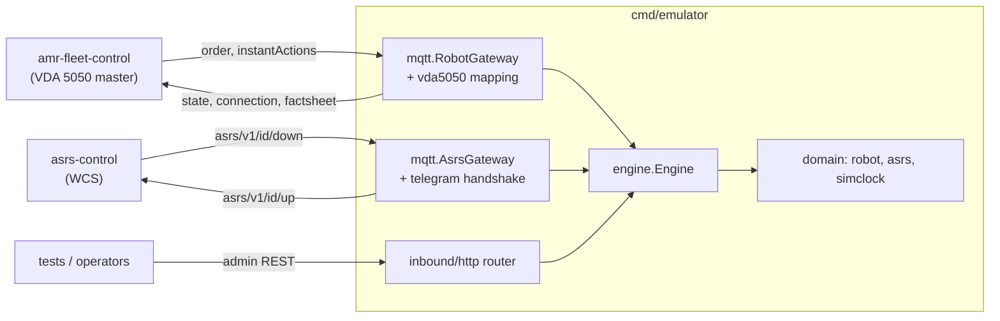

# Architecture

One binary, `cmd/emulator`, laid out like every fleet service (hexagonal, enforced by
`internal/architecture/architecture_test.go`), but with nothing behind the domain
except memory.



## Layers

```text
cmd/emulator/                  wiring: config, gateways, engine, HTTP server, tick loop
internal/domain/robot/         VDA 5050 robot model: orders, actions, battery, errors
internal/domain/asrs/          AS/RS model: rack positions, aisle units, ports, jobs
internal/domain/simclock/      monotonic simulated clock
internal/application/engine/   the world: steps devices, routes pick/drop to AS/RS ports, faults
internal/adapters/vda5050/     VDA 5050 v3 wire messages and mapping
internal/adapters/telegram/    telegram codec, ACK deduplication, retransmitter
internal/adapters/mqtt/        paho clients: one per robot, one per AS/RS
internal/adapters/inbound/http admin REST API (chi), application/problem+json errors
internal/config/               environment and world file
```

The domain depends on nothing internal but domain; the application only on domain;
adapters never on each other; only `cmd/` wires layers. `make arch-test` runs the
fitness tests.

## The simulation loop

`cmd/emulator/main.go` builds the world from `WORLD_FILE`, connects the gateways,
announces every robot (`ONLINE`, factsheet, state) and then, every `TICK_INTERVAL` of
wall time, calls `engine.Step` with `TICK_INTERVAL × SIM_SPEED` of simulated time.
A step drives robots along their released nodes, runs their actions, drains and
charges batteries, advances AS/RS jobs and publishes what changed.

A robot's `pick` or `drop` at a node that the world file maps to an AS/RS port
(`ports[].nodeId`) moves the container between the robot and the port; that is the
only coupling between the two devices.

Gateways are built before the engine they call into: until the engine is set,
`cmd/emulator/proxy.go` answers every command with the transient `NOT_READY`.

## Simulated time

`internal/domain/simclock` is advanced only by the engine. Every published message
carries simulated time, except the robots' static `CONNECTION_BROKEN` last will. The
AS/RS retransmit timer (2 s, 3 attempts) runs on real time because it is a property
of the wire. At `SIM_SPEED` 10 a shift runs in a tenth of its length. See
[ADR 0004](/docs/adr/0004-simulated-time-fault-injection-and-admin-api).

## State

All state is in memory. A restart resets the world to the world file: no
persistence, no recovery. Tests seed rack stock with `POST /asrs/{asrsId}/seeds`.
